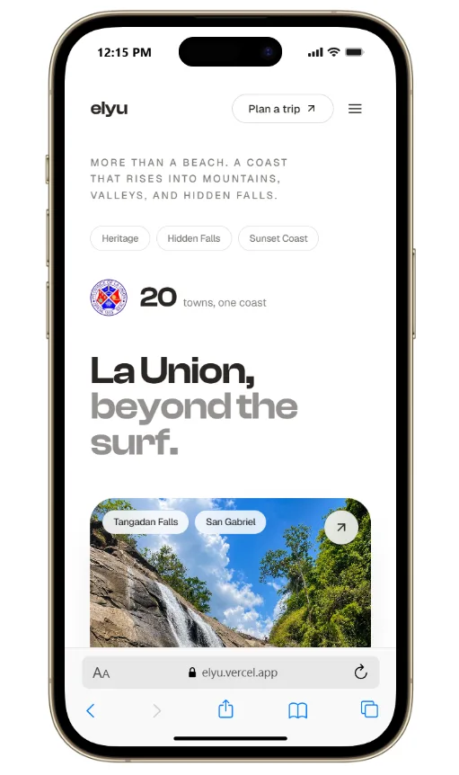
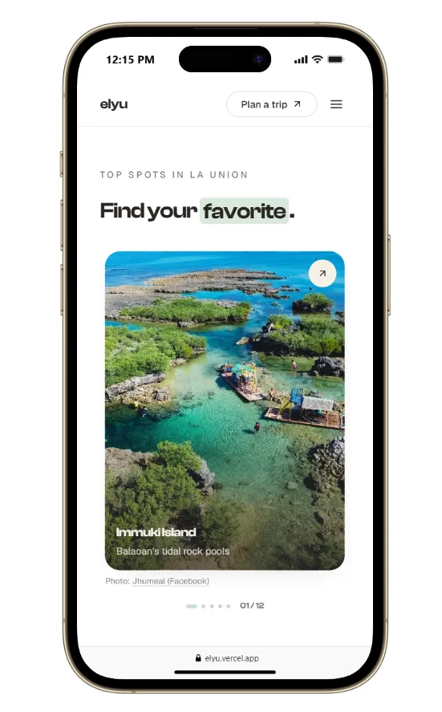
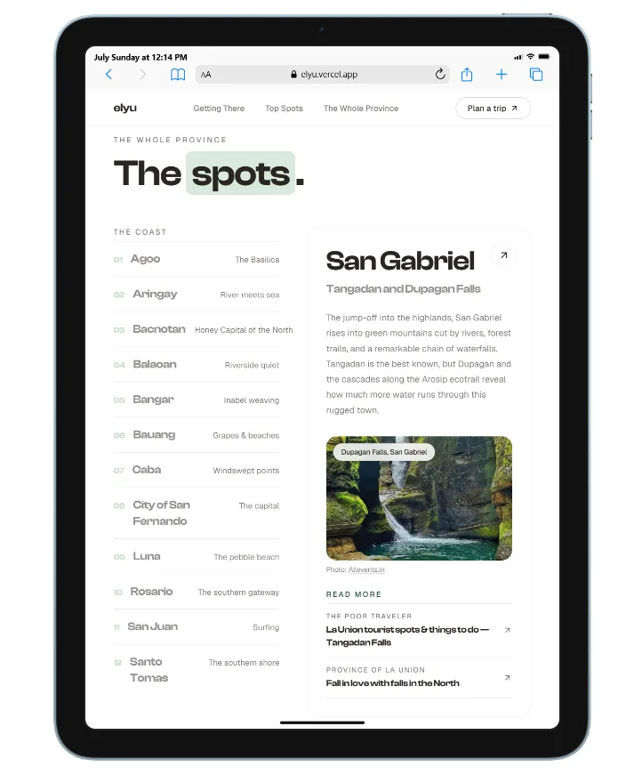

# beyond elyu

> Elyu is beyond the surf.

A single-page editorial site about **La Union** — the surf coast on the
northwest of Luzon that everyone thinks they've already seen from a weekend
day-trip. This is a small love letter arguing the opposite: that past the
crowded breaks and the day-tripper checklist, there's a place worth slowing
down for. The whole site is built to make one point — *there's more to Elyu
than the surf*.

This is a **vibe-coded side project** — made for fun, to play with a design
direction and to show off how good La Union actually is, not as a polished
product. Expect things to be a work in progress.

<p align="center">
  
  &nbsp;&nbsp;
  
</p>

<p align="center">
  
</p>

## Design direction — "Binar Nature"

North star: **"The Second Look"** — meaning that reveals itself on a longer
gaze. The chrome is deliberately quiet (a white ground and near-white cards)
so **all the real color comes from the photography**, not the interface.
Motion is choreographed: scroll-triggered reveals, staggered, ease-out, no
bounce.

| Role | Token | Color |
|---|---|---|
| Page ground | `paper` | white |
| Card surface | `card` | pure white — separated by a hairline border + soft shadow |
| Structural / primary | `sea` | `#1F4A43` — the single structural color |
| Accent | `terracotta` | `#C0623D` — highlighter marker on one word per heading |
| Text | `ink` | `#2A2622` |
| Warm-white on dark | `sand` | `#F5F0E6` — footer / hero chips only |
| Sage tint | `sea-mist` | marquee band, quiet emphasis |

- **Display type:** Clash Display, weight 600 (self-hosted)
- **Body type:** Geist (self-hosted via the `geist` package)
- Tokens, fonts, an editorial type scale, and generous spacing all live in
  the Tailwind v4 `@theme` block in [`src/app/globals.css`](src/app/globals.css),
  authored in OKLCH. The `Accent` (terracotta) and `Mark` (sage) highlighter
  markers live in [`section-header.tsx`](src/components/shared/section-header.tsx).

## Tech stack

- [Next.js 16](https://nextjs.org) (App Router, Turbopack)
- React 19 + TypeScript
- [Tailwind CSS v4](https://tailwindcss.com) (CSS-first `@theme` config)
- [shadcn](https://ui.shadcn.com) components
- Self-hosted fonts via `next/font/local` + the `geist` package (no CDN)

## Getting started

```bash
npm install
npm run dev
```

Open [http://localhost:3000](http://localhost:3000).

### Scripts

| Command | What it does |
|---|---|
| `npm run dev` | Start the dev server |
| `npm run build` | Production build |
| `npm run start` | Serve the production build |
| `npm run lint` | Run ESLint |

## Fonts

Both faces are self-hosted, so nothing is fetched from a CDN at runtime.

- **Clash Display** — the variable `.woff2` lives in
  [`src/app/fonts/`](src/app/fonts) and is wired up in
  [`src/app/layout.tsx`](src/app/layout.tsx). It's free for commercial use
  ([Fontshare](https://www.fontshare.com/fonts/clash-display), by the Indian
  Type Foundry). To swap it, replace that one file.
- **Geist** — comes from the `geist` npm package.

## Status

The page is content-complete — hero, marquee, intro, getting-there, the town
roll call, field notes, coast strip, closing, and a separate `/note` contact
page — all on the Binar Nature system. Photos are served as WebP via
`next/image`, and the SEO/AEO/GEO layer is in place: full metadata + Open Graph
card, `sitemap.xml`, `robots.txt`, JSON-LD structured data, and `/llms.txt`.

Set `NEXT_PUBLIC_SITE_URL` to the production origin at deploy — every canonical,
OG, sitemap, and llms.txt URL reads from it (falls back to a Vercel host).

---

Made with warm light and too much coffee, somewhere along the Elyu coast.
